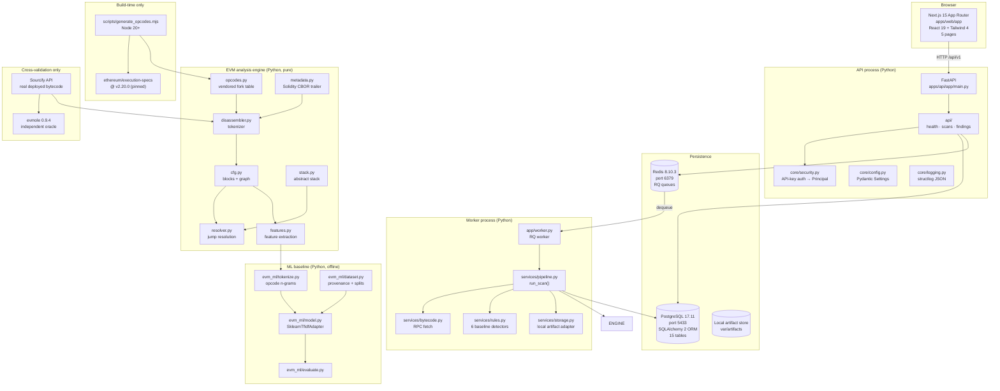
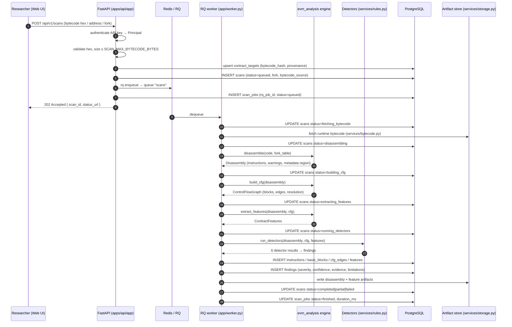
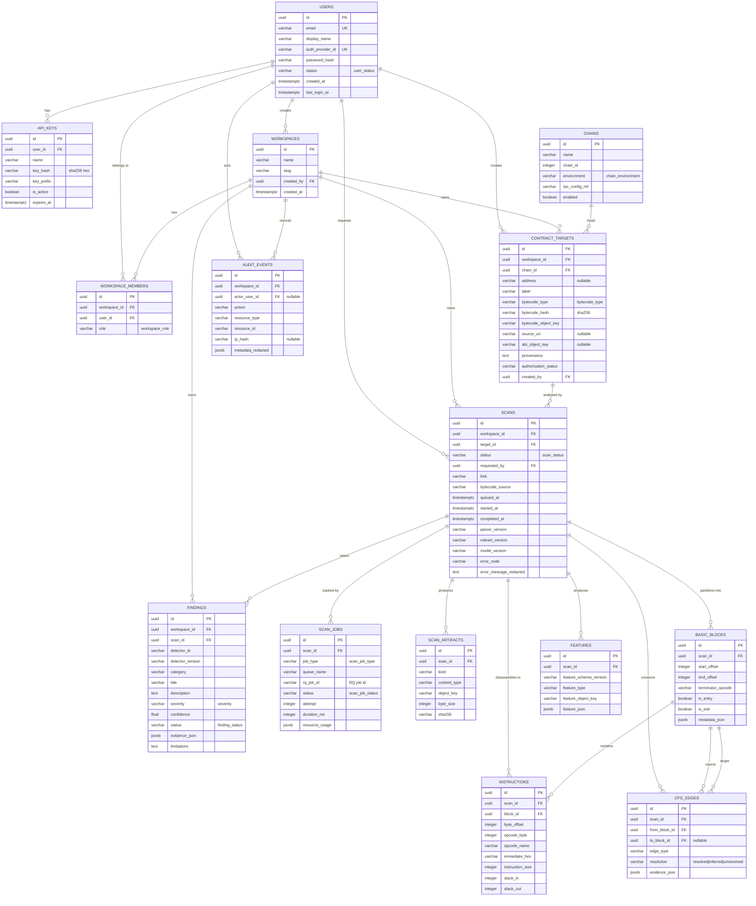
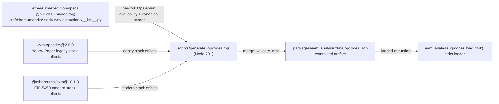

# CyberStratum — As-Built Architecture

**Scope of this document:** what actually exists in the repository as of
2026-10-28. Components that are specified but **not yet implemented** are
called out explicitly in a "Not yet built" section and are not described as if
they were. Where the design document (`CyberStratum_Product_Technical_Design_Documentation.md`)
specifies behaviour that is not built, this document says so.

Governing decisions: [`docs/adr/`](adr/README.md).

---

## 1. Component map



### 1.1 What is implemented

| Component | Location | State |
|---|---|---|
| EVM opcode table loader | `packages/evm_analysis/evm_analysis/opcodes.py` | **Complete** — 14 forks, strict loading, alias normalisation |
| Vendored opcode table | `packages/evm_analysis/data/opcodes.json` | **Complete** — generated, committed, schema `1.0.0` |
| Instruction tokenizer | `packages/evm_analysis/evm_analysis/disassembler.py` | **Complete** — PUSH immediates, truncation, unknown opcodes, n-grams |
| Solidity metadata detection | `packages/evm_analysis/evm_analysis/metadata.py` | **Complete** — minimal CBOR reader, conservative detection |
| Basic blocks + CFG | `packages/evm_analysis/evm_analysis/cfg.py` | **Complete** — leaders, edges, resolution classes, reachability, cycles |
| Abstract stack simulation | `packages/evm_analysis/evm_analysis/stack.py` | **Complete** — shape + constant tracking over a block |
| Jump-target resolver | `packages/evm_analysis/evm_analysis/resolver.py` | **Complete** — forward dataflow fixpoint, never guesses |
| Feature extraction | `packages/evm_analysis/evm_analysis/features.py` | **Complete** — deterministic numeric + n-gram features |
| Settings | `apps/api/app/core/config.py` | **Complete** — env-driven, validated at startup |
| Structured logging | `apps/api/app/core/logging.py` | **Complete** — structlog JSON |
| Error handling | `apps/api/app/core/errors.py` | **Complete** — consistent error envelope |
| API-key authentication | `apps/api/app/core/security.py` | **Complete** — static key + stored per-user keys, `Principal` |
| FastAPI application | `apps/api/app/main.py` | **Complete** — app factory, CORS, request-ID middleware, error handlers, three routers |
| API routers | `apps/api/app/api/{health,scans,findings}.py` | **Complete** — health, readiness, scan submit/list/detail, findings list/summary |
| Pydantic schemas | `apps/api/app/schemas/{health,scans,findings}.py` | **Complete** |
| Service layer | `apps/api/app/services/{pipeline,rules,bytecode,storage}.py` | **Complete** — pipeline, 6 detectors, RPC fetch, local storage adapter |
| RQ worker | `apps/api/app/worker.py` | **Complete** — `process_scan_job`, `enqueue_scan`, worker entrypoint |
| Queue connection | `apps/api/app/queue/connection.py` | **Complete** — Redis + RQ queue helper |
| ORM models | `apps/api/app/db/models/{identity,scans}.py` | **Complete** — 15 tables |
| DB session/engine | `apps/api/app/db/session.py` | **Complete** — sync engine, `session_scope()` |
| Enums | `apps/api/app/db/enums.py` | **Complete** — scan/job/finding/severity/role taxonomies |
| Alembic migrations | `apps/api/alembic/` + `alembic.ini` | **Complete** — `env.py`, template, one initial-schema revision |
| **Baseline detectors** | `apps/api/app/services/rules.py` | **Complete** — 6 rules: call-before-state-write, DELEGATECALL, SELFDESTRUCT, TX.ORIGIN, unresolved jumps, stack underflow |
| **ML baseline package** | `packages/ml_baseline/evm_ml/` | **Complete** — tokenizer, dataset, features, adapter, evaluation, manifest, model card |
| Web app | `apps/web/` | **Complete** — 5 pages (Overview, Scans, New scan, Scan detail, Findings, Reproducibility), typed API client, 9 components, 4 Vitest suites |
| Opcode generator | `scripts/generate_opcodes.mjs` | **Complete** — pinned sources, fail-loud validation |
| Cross-validation scripts | `scripts/crosscheck_evmole.py`, `scripts/validate_real_bytecode.py` | **Complete** — manual, network-dependent |
| Fixture dataset builder | `scripts/build_fixture_dataset.py` | **Complete** — builds the smoke JSONL fixture |
| Tests | `tests/unit/`, `tests/api/` | **138 Python tests** across 12 modules — 8 unit modules + 4 API modules, all passing |
| Web tests | `apps/web/src/lib/*.test.ts` | **4 Vitest suites** — `api`, `format`, `severity`, `status` |

### 1.2 Not yet built

These are **specified but absent from the repository**. Nothing in this
document should be read as claiming they work.

| Component | Expected location | Notes |
|---|---|---|
| Targets API | `apps/api/app/api/targets.py` | No router. Targets are created as a side effect of scan submission (`_upsert_target` in `api/scans.py`). |
| Findings review / triage API | `apps/api/app/api/findings.py` | Read-only: list and severity summary. No PATCH for status transitions, no reviewer decision recording. |
| Audit-log API | — | The `audit_events` table exists; no router writes to or reads from it. |
| Auth endpoints (sign-in, invite) | — | No router. Authentication is via API key only. |
| Report model and export | — | No `reports` table, no builder, no approval gate. |
| Sandbox runner | `workers/sandbox_runner/` | Empty; `SANDBOX_ENABLED=false`. The `sandbox` RQ queue name is configured but no producer or consumer exists. |
| Worker orchestration package | `workers/scan_orchestrator/` | Empty. The worker lives at `apps/api/app/worker.py` instead. |
| ML → API integration | — | `packages/ml_baseline` is a standalone, offline training/evaluation package. It is **not** wired into `services/pipeline.py`; `ENABLE_EXPERIMENTAL_ML` defaults to `false`. |
| E2E tests | `tests/e2e/` | Empty. No Playwright suite. |
| Campaign tracking | — | **Out of scope** — [ADR-0007](adr/0007-campaign-tracking-out-of-mvp-scope.md) |

---

## 2. Scan data flow

The pipeline below is the **implemented** flow. Every stage marked with a
file path exists in the repository and is exercised by the test suite.



### 2.1 Stage 1 — Bytecode intake

**Designed (design doc §5.1 steps 1–3, §6.1):** the target record captures
chain, address (nullable), bytecode type (`runtime` or `init` — never mixed
silently), the bytecode hash, an artifact object key, source URI, ABI key,
provenance, and authorization status.

**Implemented in the ORM:** `contract_targets` carries exactly these columns —
`workspace_id`, `chain_id`, `address`, `label`, `bytecode_type`, `bytecode_hash`,
`bytecode_object_key`, `source_uri`, `abi_object_key`, `provenance`,
`authorization_status`, `created_by`, `created_at`. The `bytecode_type` enum is
`RUNTIME | INIT`; `authorization_status` is
`AUTHORIZED | UNVERIFIED | UNKNOWN`.

**Implemented in the API:** `POST /api/v1/scans` (`apps/api/app/api/scans.py`)
accepts bytecode hex or an address to fetch, validates the hex and its size
against `SCAN_MAX_BYTECODE_BYTES`, resolves the workspace and chain, and
upserts the target through `_upsert_target()` before creating the scan. The
bytecode hash is computed at intake and stored on the target.

**Not implemented:** a standalone targets router, and the ABI ingestion path
(`abi_object_key` is nullable and no component populates it).

### 2.2 Stage 2 — Disassembly

**Implemented** in `packages/evm_analysis/evm_analysis/disassembler.py`.

```python
disassemble(code: bytes, table: ForkTable, *, detect_metadata: bool = True) -> Disassembly
```

Behaviour:

- Decodes the **instruction stream**, never raw hex bytes. Each `Instruction`
  records `offset`, `opcode`, `name`, `immediate`, `size`, `stack_in`,
  `stack_out`, `terminating`, and a `status`.
- **`PUSH1`–`PUSH32` immediates are consumed, not decoded.** `push_bytes` comes
  from the fork table, so the immediate width is fork-correct.
- **Truncated PUSH** at the end of the code is *reported*, not dropped:
  `InstructionStatus.TRUNCATED_IMMEDIATE`, and the instruction still occupies
  the bytes it actually consumed. `Disassembly.is_truncated` exposes this.
- **Unknown in this fork** → `InstructionStatus.UNKNOWN_OPCODE`, one byte wide,
  plus a warning naming the fork. The rest of the code is still visible.
- **`0xFE`** (the designated invalid opcode, deliberately absent from every
  fork table) → `InstructionStatus.INVALID_OPCODE`.
- **Solidity metadata trailer is not decoded as instructions.** See §2.3.
- The disassembly is **deterministic**: the same bytes and the same fork always
  produce the same instruction list.

`Disassembly` exposes `opcode_histogram()`, `ngrams(n)`, `jumpdests`,
`instruction_at(offset)`, `executable_size`, and aggregates the warnings.

### 2.3 Solidity metadata (CBOR) trailer

**Implemented** in `packages/evm_analysis/evm_analysis/metadata.py`.

Solc appends a CBOR blob plus a 2-byte big-endian length to the end of the
runtime bytecode. Decoding it as instructions produces a tail of bogus
`INVALID` opcodes, a spurious block (the trailer's first byte is usually
`PUSH`-shaped), and an inflated instruction count that every downstream
artifact is keyed on.

`detect_solidity_metadata(code)` is **conservative**: it requires the trailing
length field to be consistent, the CBOR to decode exactly (a minimal reader
covering definite-length maps, byte strings, text strings, integers, arrays,
booleans, and null), and the decoded map to carry at least one key solc writes
(`solc`, `bzzr0`, `bzzr1`, `ipfs`, `experimental`). A false positive therefore
requires a very specific coincidence.

The module **never mutates the caller's bytes** (§6.2 requires the original
artifact to remain available). `MetadataRegion` exposes `start_offset`,
`length`, `cbor_length`, `entries`, `raw`, `compiler_version`, and a
`confidence` of `high` (compiler version known) or `medium`.

When a region is found, `disassemble()` stops decoding at
`region.start_offset` and records a warning. `Disassembly.executable_size`
returns the executable length.

### 2.4 Stage 3 — Basic blocks and control-flow graph

**Implemented** in `packages/evm_analysis/evm_analysis/cfg.py`.

```python
build_cfg(disassembly: Disassembly) -> ControlFlowGraph
```

**Block boundaries** (design doc §6.3) occur at:

- the first instruction;
- every valid `JUMPDEST`;
- the instruction after any terminator (`STOP`, `RETURN`, `REVERT`, `INVALID`,
  `SELFDESTRUCT`) or branch (`JUMP`, `JUMPI`).

Blocks are keyed by their **start offset**, so they are stable across re-runs.
Each `Block` carries `start`, `end`, its `instructions`, and its `terminator`.

**Edges** carry an `EdgeType` and a `Resolution`:

| `EdgeType` | `Resolution` | Meaning |
|---|---|---|
| `FALLTHROUGH` | `RESOLVED` | Ordinary fall-through to the next block |
| `UNCONDITIONAL_JUMP` | `RESOLVED` / `INFERRED` / `UNRESOLVED` | `JUMP`; target known, inferred, or dynamic |
| `CONDITIONAL_JUMP` | `RESOLVED` / `INFERRED` / `UNRESOLVED` | `JUMPI` taken edge |
| `CONDITIONAL_FALLTHROUGH` | `RESOLVED` | `JUMPI` not-taken edge |
| `RETURN`, `REVERT`, `STOP`, `INVALID`, `SELFDESTRUCT` | `RESOLVED` | Terminal transfer, no successor |
| `UNRESOLVED` | `UNRESOLVED` | Dynamic destination |

**The CFG is not assumed to be a DAG.** `ControlFlowGraph.find_cycles()`
implements an iterative DFS with white/grey/black colouring that terminates on
cyclic graphs and returns elementary cycles. Design doc §6.3 is explicit that
loops are normal in Solidity.

**Reachability.** `_mark_reachable(cfg)` walks from `entry_offset` and marks
each block reachable or not, producing `reachable_blocks`,
`unreachable_blocks`, `reachable_block_count`, `unreachable_regions` (byte
ranges), and `unreachable_byte_size` — the share of the contract that control
flow can never reach.

**Unresolved jumps are surfaced, never hidden.** Every edge whose resolution is
`UNRESOLVED` produces a warning naming the kind of branch and the offset.

### 2.5 Stage 3b — Jump-target resolution

**Implemented** across `resolver.py` and `stack.py`.

`build_cfg` resolves jump targets in **two passes**:

1. **Heuristic pass.** The narrow "the instruction immediately before the jump
   is a `PUSHn`" rule. This is enough to give the dataflow fixpoint a graph
   to walk.
2. **Abstract-simulation pass.** `resolve_jump_targets(disassembly, cfg)` runs a
   small abstract interpreter over the block graph:
   - a forward dataflow fixpoint computes the stack depth at each block entry,
     so **loops converge**;
   - each block is then simulated to track which stack slots hold known
     constants;
   - a branch whose destination slot holds a constant is resolved.

The abstract stack (`stack.py`) tracks **shape** and **known constants**. A slot
holds either a known constant or `None` (unknown). `PUSH` pushes its immediate;
`DUP`/`SWAP` shuffle; `POP` pops. Any other instruction consumes `stack_in`
slots and produces `stack_out` unknown slots — and if the modelled depth is too
shallow, the whole stack is **cleared rather than silently mis-modelled**.

This matters because `solc` frequently shuffles the destination before
branching:

```text
PUSH2 <target>   ; the destination
DUP2             ; duplicate it
JUMPI
```

Here the destination is on top of the stack at the branch but is *not* the
instruction immediately before it, so the heuristic alone would miss it.

**The resolver never guesses.** Where two paths reach a block with different
stack depths, the depth is marked **unknown** rather than resolved to a
winner, and the branch stays unresolved. Blocks reachable only through a
dynamic transfer keep an unknown entry stack — propagating a single path's
shape through a dynamic edge would flood every `JUMPDEST` block and poison the
dataflow. The fixpoint is bounded at 16 rounds so a pathological input cannot
hang the scanner, and blocks are always processed in ascending offset order so
the result is deterministic.

Finally, a resolved target is kept only if it is a real `JUMPDEST` **and** a
real block.

### 2.6 Stage 4 — Feature extraction

**Implemented** in `packages/evm_analysis/evm_analysis/features.py`.

```python
extract_features(disassembly: Disassembly, cfg: ControlFlowGraph, ngram_size: int = 3) -> ContractFeatures
```

`ContractFeatures` carries:

- **Counts:** `code_size`, `instruction_count`, `block_count`,
  `reachable_block_count`, `unreachable_byte_size`, `edge_count`,
  `branch_count`, `unresolved_jump_count`, `cycle_count`.
- **Distributions:** `opcode_histogram`, `opcode_frequencies`, `ngram_size`,
  `ngram_frequencies` (default N = 3, per §6.2).
- **Locations:** `call_offsets` (`CALL`/`CALLCODE`/`DELEGATECALL`/`STATICCALL`),
  `create_offsets` (`CREATE`/`CREATE2`), `storage_read_offsets`
  (`SLOAD`/`TLOAD`), `storage_write_offsets` (`SSTORE`/`TSTORE`).
- **Ordering:** `call_then_storage_write` — `(call_offset, storage_write_offset)`
  pairs where a storage write follows an external call **within the same
  block**. This is the classic reentrancy *shape*; §6.5 is explicit that it is
  a heuristic, not proof.
- **Stack:** `stack_underflow_offsets`, `max_stack_depth`. The stack-depth
  tracker is a deliberately conservative linear approximation that does not
  model branches — it is a signal, never a reachability proof.
- **Metadata:** `metadata_size`, `compiler_version`.
- **Warnings:** the concatenation of the disassembly and CFG warnings.

`as_vector()` flattens the features into a numeric mapping for the ML
baseline: 16 scalar features plus one `opcode_freq__<NAME>` feature per
opcode.

Everything here is **pure and reproducible**: the same bytecode and fork always
produce the same feature vector.

### 2.7 Stage 5 — Detectors

**Implemented** in `apps/api/app/services/rules.py`. Six baseline detectors
run on every scan. Each returns a `DetectorResult` with an id, version,
category, severity, confidence, evidence, limitations, and the offsets it
touched.

| Detector id | Category | What it looks for | Severity | Confidence |
|---|---|---|---|---|
| `baseline.call_before_state_write` | `reentrancy_candidate` | An external `CALL` preceding an `SSTORE` in the same basic block | Medium | 0.55 |
| `baseline.delegatecall` | `delegatecall_usage` | `DELEGATECALL` to an untrusted, non-immutable address | High | 0.70 |
| `baseline.selfdestruct` | `selfdestruct_usage` | `SELFDESTRUCT` reachable | Medium | 0.60 |
| `baseline.tx_origin` | `tx_origin_dependency` | Any read of `ORIGIN` (privilege derived from `tx.origin`) | Low | 0.60 |
| `baseline.unresolved_jumps` | `analysis_limitation` | Jumps the resolver could not prove to an in-range target; confidence scales with the unresolved ratio | Info | `min(ratio, 1.0)` |
| `baseline.stack_underflow` | `bytecode_anomaly` | An instruction whose stack consumption exceeds the tracked depth | Low | 0.50 |

The reentrancy rule is deliberately a **heuristic**, exactly as design-doc §6.5
requires. Its `title` is worded "Potential reentrancy pattern — manual
validation required", and its `limitations` field states that an external
call does not by itself prove reentrancy. Control-flow-transfer, value,
guards, and check-effects-interactions analysis are **not** implemented.

Design-doc §6.6 requires severity and confidence to be **separate** fields,
and they are: `findings.severity` is an enum, `findings.confidence` is a
separate `Float`.

### 2.8 Stage 6 — ML scoring

**Implemented as an offline package, not wired into the scan pipeline.**

The ML baseline is **scikit-learn TF-IDF over opcode n-grams** plus the numeric
features from §2.6. The GNN is **deferred**, not scheduled. The full rationale
and the four conditions that would reopen it are in
[ADR-0006](adr/0006-scikit-learn-tfidf-baseline-gnn-deferred.md).

The package lives at `packages/ml_baseline/evm_ml/`:

| Module | Purpose |
|---|---|
| `tokenize.py` | Opcode n-gram tokenizer; skips PUSH immediates and the metadata region |
| `dataset.py` | Provenance-tracked records, family/project-level splits, no leakage between splits |
| `features.py` | Numeric feature assembly consistent with `evm_analysis.features` |
| `model.py` | `SklearnTfidfAdapter` — fit/predict with a persisted, versioned vocabulary |
| `evaluate.py` | Metrics and threshold selection |
| `manifest.py` | Model manifest (version, vocabulary hash, training data fingerprint) |
| `model_card.py` | Model card generation |
| `report.py` | Markdown evaluation report |

Design-doc §6.2 constraints that the implementation honours: the TF-IDF
vocabulary is fit **only on the training corpus**, persisted, versioned, and
reused for inference; splits are at contract/project/family level, never at
random bytecode-fragment level; and raw and normalised features stay separate.

**Not implemented:** the ML package is **not** called by
`apps/api/app/services/pipeline.py`. `ENABLE_EXPERIMENTAL_ML` defaults to
`false` in both `.env.example` and `apps/api/app/core/config.py`, and the
scanner must run with ML disabled. A scan produces detector findings only;
no ML score is attached to any finding.

The `features` table carries `feature_schema_version`, `feature_type`, a
`feature_object_key`, and `feature_json` — the versioned-feature plumbing
exists and is written by the pipeline.

### 2.9 Stage 7 — Reporting

**Partially implemented.** The `findings` and `scan_artifacts` tables exist and
are written by the pipeline. The API exposes findings read access:

- `GET /api/v1/findings` — filtered list (by scan, severity, category, status)
- `GET /api/v1/findings/summary` — severity breakdown

**Not implemented:** the `reports` table, the report builder, the export
format, and the reviewer-approval gate. Finding status transitions have no
API — the `status` column exists but nothing updates it.

The web app renders findings through `apps/web/app/findings/page.tsx` and the
`FindingTable` component, reading from the API rather than from a report
artifact.

---

## 3. Database entities

Fifteen tables are defined in `apps/api/app/db/models/`. All primary keys are
UUIDs; all timestamps are timezone-aware (`DateTime(timezone=True)`) with
server defaults of `now()`. The declarative base uses a **deterministic
constraint naming convention** so Alembic autogenerate diffs stay stable.

### 3.1 Entity-relationship diagram



### 3.2 Table-to-design-doc mapping

| Model | Design doc §9.1 table | Notes |
|---|---|---|
| `users` | `users` | Adds `password_hash` and `status` |
| `api_keys` | — | New. Needed for machine access; keys stored as SHA-256 digests with a display prefix |
| `workspaces` | `workspaces` | |
| `workspace_members` | `workspace_members` | UUID PK rather than a composite key; role enum instead of a free string |
| `chains` | `chains` | |
| `contract_targets` | `contract_targets` | |
| `scans` | `scans` | Adds `fork` and `bytecode_source`; `model_version` nullable |
| `scan_jobs` | `scan_jobs` | Adds `rq_job_id` (the RQ job id) |
| `scan_artifacts` | — | New. A single index of artifacts per scan (bytecode, disassembly, features) |
| `instructions` | `instructions` | `stack_in`/`stack_out` are `Integer` (not the nullable `_nullable` of the doc) |
| `basic_blocks` | `basic_blocks` | |
| `cfg_edges` | `cfg_edges` | |
| `features` | `features` | |
| `findings` | `findings` | `severity` and `confidence` are separate fields, as §6.6 requires |
| `audit_events` | `audit_events` | `metadata_redacted` — redaction happens before write |

**Deliberately absent** (see [ADR-0007](adr/0007-campaign-tracking-out-of-mvp-scope.md)):
`campaigns`, `campaign_tasks`, `wallet_labels`, `campaign_activity`,
`reward_records`. Also absent from the doc's list: `finding_feedback`,
`reproduction_jobs`, `reports`, `model_versions`, `datasets` — these are
specified in §9.1 but not yet modelled.

### 3.3 Enumerations

`apps/api/app/db/enums.py` defines string enums shared by the ORM and the API
schemas:

| Enum | Values |
|---|---|
| `ScanStatus` | `queued`, `fetching_bytecode`, `disassembling`, `building_cfg`, `extracting_features`, `running_detectors`, `completed`, `partial`, `failed`, `cancelled` |
| `ScanJobStatus` | `queued`, `started`, `finished`, `failed` |
| `ScanJobType` | `scan`, `reproduction` |
| `FindingStatus` | `new`, `triage`, `confirmed`, `false_positive`, `needs_more_evidence` |
| `Severity` | `critical`, `high`, `medium`, `low`, `info` |
| `ChainEnvironment` | `mainnet`, `testnet`, `local` |
| `BytecodeType` | `runtime`, `init` |
| `AuthorizationStatus` | `authorized`, `unverified`, `unknown` |
| `UserStatus` | `active`, `invited`, `suspended` |
| `WorkspaceRole` | `owner`, `admin`, `researcher`, `reviewer`, `viewer` |

`ScanStatus` mirrors the pipeline stages of design doc §5.1 and ends in
`completed` / `partial` / `failed` as §5.1 step 9 requires. `FindingStatus`
mirrors the review workflow of §5.2. The enums are stored as `VARCHAR` with
`native_enum=False`, so adding a value is a code change plus a migration rather
than a Postgres `ALTER TYPE`.

---

## 3A. HTTP API surface

The FastAPI application is built in `apps/api/app/main.py` via a
`create_app()` factory. It installs CORS, a request-ID middleware, and
consistent error handlers, and mounts three routers.

All routes are under `/api/v1` and **all require an API key** except the
liveness probe.

| Method | Path | Handler | Purpose |
|---|---|---|---|
| `GET` | `/health` | `api/health.py` | Liveness. Does not touch the database or Redis |
| `GET` | `/api/health` | `api/health.py` | Readiness. Checks PostgreSQL and Redis, returns per-dependency status and a 503 when degraded |
| `POST` | `/api/v1/scans` | `api/scans.py` | Submit a scan (bytecode hex or address, fork). Creates the target if needed, creates the scan, enqueues the RQ job, returns `202` with the scan id and a status URL |
| `GET` | `/api/v1/scans` | `api/scans.py` | List scans. `limit` (1–200, default 50), `offset`, `status`, `workspace_id` |
| `GET` | `/api/v1/scans/{scan_id}` | `api/scans.py` | Scan detail — status, stage, counts, reproducibility facts |
| `GET` | `/api/v1/findings` | `api/findings.py` | List findings. `limit`, `offset`, `severity`, `status`, `category`, `scan_id`, `workspace_id` |
| `GET` | `/api/v1/findings/summary` | `api/findings.py` | Severity breakdown across findings |

The OpenAPI document is served at `/openapi.json`, with Swagger UI at `/docs`
and ReDoc at `/redoc`.

**Not exposed:** there is no `PATCH`/mutation for findings, no audit-log
endpoint, no auth (sign-in/invite) endpoint, no targets endpoint, and no
report export endpoint.

### 3A.1 Frontend ↔ API contract gaps

The frontend API client (`apps/web/src/lib/api.ts`) was written against the
design document's route names, and **three calls it makes are not served by
the current backend**:

| Frontend call | Backend status | Effect |
|---|---|---|
| `GET /api/v1/scans/{id}/findings` | **Not implemented** | The scan-detail page requests findings this way; the request 404s and the page renders its error state even though the scan itself loads |
| `POST /api/v1/targets` | **Not implemented** | Reached only as a fallback: `createScan()` first tries `POST /api/v1/scans`, and falls back to the targets flow on a 404 |
| `POST /api/v1/targets/{id}/scans` | **Not implemented** | Same fallback path |
| `GET /api/v1/findings/{id}` | **Not implemented** | `getFinding()` is exported but not used by any page |

The primary path — `POST /api/v1/scans` — works, so scan submission is
functional. The gaps are real and are listed here rather than papered over.

Two further naming differences exist between the two sides but are handled
tolerantly by the client: the frontend sends `status`/`severity`/`category`
query parameters (which the backend expects), and the backend's readiness
endpoint is `/api/health` while the frontend's `getHealth()` reads
`/api/v1/health`. The frontend's `getHealth()` therefore returns a 404
against the current backend.

**The frontend sends no API key.** `apps/web/src/lib/api.ts` sets only
`Accept` and `Content-Type`; `apps/web/.env.example` defines
`NEXT_PUBLIC_API_BASE_URL` and nothing else. Every authenticated API
endpoint therefore returns `401` to the web app until an API-key mechanism is
added to the client. This is a known, open gap — it is not a configuration
issue, and it is not fixed by any environment variable that currently
exists.

### 3A.2 Authentication

`apps/api/app/core/security.py` resolves the incoming `X-API-Key` header to a
`Principal`. **`Authorization: Bearer` is not accepted** — the header name is
the only supported carrier:

- A **static key** from `settings.api_key` produces a service principal
  (`Principal.is_service_key` is `True`). This is how a single-developer local
  setup authenticates.
- A **stored key** is looked up by SHA-256 digest in `api_keys.key_hash`; the
  owning user must be `active` for the request to proceed.

A raw key is never persisted — only its SHA-256 digest and a short display
prefix are stored.

### 3A.3 The worker

`apps/api/app/worker.py` holds `enqueue_scan()` (used by the API to push a job
onto the `scans` RQ queue) and `process_scan_job()` (the RQ job function that
the worker executes). `apps/api/app/queue/connection.py` builds the Redis
connection and the RQ queue.

`process_scan_job()` drives `services/pipeline.py::run_scan()`, which
performs the fetch → disassemble → CFG → features → detectors sequence
described in §2 and writes the results to PostgreSQL and the artifact store.

The queue names are configured (`scans`, `sandbox`, `reproduction`); only the
`scans` queue has a producer and a consumer today.

---

## 4. Artifact and reproducibility model

Design doc §15 requires that "every scan stores parser/rules/model/feature
versions and input hash", and §5.1 step 9 requires a scan to be marked
complete, partial, or failed "with reason and tool/model versions".

### 4.1 The identity of a scan

A scan is reproducible from four stored facts:

| Fact | Where it is stored |
|---|---|
| **Input hash** | `contract_targets.bytecode_hash` (SHA-256 of the original artifact) and `scan_artifacts.sha256` per artifact |
| **Opcode table version** | The `sources` provenance string and `schemaVersion` in `packages/evm_analysis/data/opcodes.json`; recorded via `scans.parser_version` |
| **Fork** | `scans.fork` — the exact EVM fork the disassembly used |
| **Tool versions** | `scans.parser_version`, `scans.ruleset_version`, `scans.model_version` (nullable when ML is disabled) |

The frontend mirrors this in its `Reproducibility` type
(`apps/web/src/lib/types.ts`): `toolVersions`, `opcodeTableVersion`,
`bytecodeHash`, `rulesetVersion`, `modelVersion`, `featureSchemaVersion`, and
`environment`.

### 4.2 The artifact store

Artifacts are addressed by an **object key**, never by a public URL. The
`scan_artifacts` table indexes them: `kind`, `content_type`, `object_key`,
`byte_size`, `sha256`, `created_at`.

`OBJECT_STORAGE_DRIVER=local` with `OBJECT_STORAGE_ROOT=./var/artifacts` is the
development driver. `SIGNED_URL_TTL_SECONDS=300` sets the signed-URL lifetime
for private downloads. The `var/` directory is git-ignored.

### 4.3 The bytecode artifact is never modified

§6.1 and §6.2 both require the original artifact to remain available. The
metadata detector honours this: it never mutates the caller's bytes, it reports
*where* the trailer starts and what it contains, and `MetadataRegion.raw`
preserves the exact trailer bytes. The executable/code split is expressed by
offsets, not by rewriting the input.

### 4.4 The opcode table is a pinned, committed artifact

`packages/evm_analysis/data/opcodes.json` carries:

```json
{
  "schemaVersion": "1.0.0",
  "generator": "scripts/generate_opcodes.mjs",
  "sources": {
    "opcodes": "ethereum/execution-specs@v2.20.0 (src/ethereum/forks/<fork>/vm/instructions)",
    "stackEffects": [
      "evm-opcodes@2.0.0 (legacy opcodes)",
      "@ethereumjs/evm@10.1.3 (dist/esm/eof/stackDelta.js, modern opcodes)"
    ]
  },
  "forks": [ ... 14 forks ... ],
  "opcodes": { ... }
}
```

The `sources` string is the provenance stamp that a scan records. The file is
committed so the Python engine needs **no Node dependency at runtime** and so
the table is diffable and reviewable. See
[ADR-0004](adr/0004-custom-vendored-opcode-table.md).

### 4.5 Determinism

Given the same bytecode, the same fork, and the same table, the engine
produces byte-identical output:

- the disassembler is a pure left-to-right scan;
- the CFG builder sorts leaders and blocks by offset;
- the resolver processes blocks in ascending offset order and resolves
  conflicts by marking a state *unknown* rather than picking a winner;
- feature extraction sorts histogram and n-gram keys.

---

## 5. The fork-aware opcode pipeline

This is the part of the system where correctness is hardest to eyeball, so it
is described in full.

### 5.1 Why fork-awareness is not optional

An opcode's meaning depends on the fork. `PUSH0` (EIP-3855) does not exist
before Shanghai; `MCOPY` (EIP-5656) and `TLOAD`/`TSTORE` (EIP-1153) do not
exist before Cancun; `REVERT` (EIP-140) does not exist before Byzantium;
`SHL`/`SHR`/`SAR` (EIP-145) do not exist before Constantinople. Decoding
bytecode as if it were a newer fork invents instructions that the EVM would
never execute, and decoding it as if it were an older fork silently misses real
ones.

The vendored table covers fourteen forks, oldest to newest:

| Fork | Opcodes in table |
|---|---|
| `frontier` | 129 |
| `homestead` | 130 |
| `tangerine_whistle` | 130 |
| `spurious_dragon` | 130 |
| `byzantium` | 134 |
| `constantinople` | 139 |
| `petersburg` | 139 |
| `istanbul` | 141 |
| `berlin` | 141 |
| `london` | 142 |
| `paris` | 142 |
| `shanghai` | 143 |
| `cancun` | 148 |
| `prague` | 148 |

`petersburg` has no directory in execution-specs — it differed from
Constantinople only by reverting EIP-1283 (net gas metering), which changes gas
costs and not the opcode set — so the generator maps it to `constantinople`
explicitly.

### 5.2 The generation pipeline



**Source-of-truth split:**

| Concern | Source | Why |
|---|---|---|
| Which opcodes exist in which fork | `ethereum/execution-specs` @ `v2.20.0` | The authoritative per-fork `Ops` enum |
| Canonical names (`PUSH1`…`PUSH32`, `DUP1`…`DUP16`) | `ethereum/execution-specs` | Same source, so names and availability cannot disagree |
| Stack effects, legacy opcodes | `evm-opcodes` | Yellow-Paper derived; covers the classic set |
| Stack effects, modern opcodes | `@ethereumjs/evm` | EIP-5450 metadata; covers `PUSH0`, `MCOPY`, `TLOAD`, `TSTORE` |

Each fork's set is read **independently** rather than assuming cumulative
inheritance.

### 5.3 Fail-loud generation

The generator refuses to emit a table when:

- the two stack-effect sources **disagree** on any opcode (it prints both
  values and exits non-zero);
- a fork contains a duplicate opcode code;
- `0xFE` appears as a valid instruction (it is the *designated invalid*
  opcode, so execution-specs correctly omits it from every fork);
- a core opcode (`0x00`, `0x01`, `0x56`, `0x57`, `0xF3`, `0xFF`) is missing
  from a fork;
- `PUSH1` is not parsed as `PUSH1` with `pushBytes = 1`;
- a newer fork **drops** an opcode present in its predecessor;
- any known opcode lacks a stack effect.

It also runs hard-coded spot-checks: `ADD` 2/1, `SSTORE` 2/0, `PUSH0` 0/1,
`PUSH1` 0/1, `MCOPY` 3/0, `RETURN` 2/0; and fork-introduction checks —
`PUSH0` absent from `frontier` but present from `shanghai`; `MCOPY` absent from
`shanghai` but present from `cancun`; `REVERT` absent from `frontier` but
present from `byzantium`; `SHL` absent from `byzantium` but present from
`constantinople` and `paris`.

One subtlety the generator handles explicitly: `@ethereumjs/evm`'s stack-delta
table stringifies opcode keys as **decimal** (`"96"`), not hex (`"0x60"`).
Parsing them as hex would silently corrupt every code ≥ 10. The generator
detects the literal form instead of assuming a radix, and throws on an
unparseable key.

### 5.4 Strict loading at runtime

`evm_analysis.opcodes.load_fork(fork)`:

- raises `ValueError` for an unsupported fork, listing the supported ones;
- raises `ValueError` for an opcode entry missing a stack effect;
- raises `ValueError` for a duplicate opcode code;
- raises `FileNotFoundError` with the regeneration command if the artifact is
  missing;
- `normalize_fork()` is case- and separator-tolerant but still rejects an
  unknown fork.

There is **no silent degradation**. A wrong opcode table would corrupt every
downstream finding, so the loader fails loudly instead.

`canonical_opcode_name()` normalises an opcode name arriving from another
toolchain, so a name from a different source can be mapped onto the canonical
name in this table.

### 5.5 The fork parameter end to end

```text
HTTP request / scan row
      │
      ▼
scans.fork  (e.g. "cancun")
      │
      ▼
load_fork(fork) → ForkTable  (strict; raises on unknown)
      │
      ▼
disassemble(code, table) → Disassembly
      │                        │
      │                        └── fork recorded on the Disassembly
      ▼
build_cfg(disassembly) → ControlFlowGraph
      │
      ▼
extract_features(disassembly, cfg) → ContractFeatures  (fork carried through)
```

`DEFAULT_EVM_FORK` in `apps/api/app/core/config.py` sets the default
(`prague`), and the `scans.fork` column defaults to `cancun`. **Known
inconsistency:** the config validator still accepts `osaka`, which the vendored
table does not contain; `load_fork("osaka")` raises at analysis time. This is
recorded in [ADR-0004](adr/0004-custom-vendored-opcode-table.md) and should be
fixed by extending the generator's fork list or removing `osaka` from the
validator.

---

## 6. Cross-validation

The engine is checked against an **independent** implementation, `evmole`
0.9.4 (a Rust engine with a Python binding). `evmole` is a **validation
oracle only** and is never in the production path. See
[ADR-0005](adr/0005-evmole-as-cross-validation-oracle.md).

`scripts/crosscheck_evmole.py` compares instruction-by-instruction:

| Check | Requirement |
|---|---|
| Instruction count | Must match exactly |
| Byte offsets | Must match for every instruction |
| Opcode names | Must match for every instruction |

`scripts/validate_real_bytecode.py` fetches deployed runtime bytecode, runs the
full disassembly → CFG → feature pipeline, and cross-checks the instruction
count against `evmole`.

The fixtures are real, publicly-verified mainnet contracts, fetched from
Sourcify: USDC, WETH, DAI, Uniswap V2 Router, Uniswap V3 SwapRouter02,
SushiSwap Router, Aave V3 Pool, Lido stETH.

Both scripts require network access and are **manual tools, not CI tests**.

---

## 6A. Test suite status

The Python suite is run with:

```bash
cd /e/projects/cyberstratum
.venv/Scripts/python.exe -m pytest -q
```

**138 tests are collected across 12 modules, and all 138 pass.** The suite
covers the opcode table, the disassembler, the CFG, metadata detection, the
resolver, the ML tokenizer/dataset/pipeline, and the API (scans, findings,
worker, health).

| Suite | Tests | Result |
|---|---|---|
| `tests/unit/test_opcodes.py` | 36 | Pass |
| `tests/unit/test_disassembler.py` | 15 | Pass |
| `tests/unit/test_cfg.py` | 13 | Pass |
| `tests/unit/test_metadata.py` | 10 | Pass |
| `tests/unit/test_resolver.py` | 7 | Pass |
| `tests/api/test_scans.py` | 7 | Pass |
| `tests/api/test_findings.py` | 5 | Pass |
| `tests/api/test_worker.py` | 4 | Pass |
| `tests/api/test_health.py` | 3 | Pass |
| `tests/unit/test_ml_tokenize.py` | 16 | Pass |
| `tests/unit/test_ml_pipeline.py` | 11 | Pass |
| `tests/unit/test_ml_dataset.py` | 11 | Pass |

The API tests use `TestClient` against the real app with a real PostgreSQL
test database; `tests/api/conftest.py` reads `TEST_DATABASE_URL`, drops and
recreates the schema per session, and resets the engine. The worker tests
drive `process_scan_job()` directly and assert that findings are recorded,
that a missing-bytecode scan is marked failed, that the job is marked
finished, and that a scan id that does not exist is handled.

The web suite is run with `npm run test` in `apps/web/` (Vitest).

---

## 7. Frontend

**Complete.** `apps/web/` is a Next.js 15.5 App Router project with React 19,
TypeScript 5.8, Tailwind 4, and Vitest. It is a workspace member of the root
`package.json`. The App Router lives at `apps/web/app/` (not `src/app/`).

Pages present:

| Route | Purpose |
|---|---|
| `app/page.tsx` | Overview / dashboard — scan counts and severity distribution |
| `app/scans/page.tsx` | Scan list, with filtering |
| `app/scans/new/page.tsx` | New-scan form (bytecode hex or address, fork selection) |
| `app/scans/[scanId]/page.tsx` | Scan detail — stage timeline, findings, reproducibility |
| `app/findings/page.tsx` | Findings list with severity filter |
| `app/reproducibility/page.tsx` | Reproducibility view (bytecode hash, opcode-table version, tool versions) |

Shared code:

| Path | Purpose |
|---|---|
| `src/lib/types.ts` | Canonical domain types: `Severity`, `ScanStatus`, `ReviewStatus`, `StageStatus`, `ScanStage`, `Artifact`, `ToolVersion`, `Reproducibility`, `SeverityCounts`, `ScanSummary` |
| `src/lib/api.ts` | API client; normalises snake_case/camelCase and bare-array/`{data: []}` envelopes into the canonical types |
| `src/lib/severity.ts`, `status.ts`, `format.ts` | Severity ordering, status mapping, formatting helpers |
| `src/components/SeverityBadge.tsx` | Severity display |
| `src/components/StatusBadge.tsx` | Scan/finding status display |
| `src/components/StageTimeline.tsx` | Pipeline stage visualisation |
| `src/components/RiskScoreGauge.tsx` | Confidence display |
| `src/components/ScanTable.tsx`, `FindingTable.tsx` | Table primitives |
| `src/components/NewScanForm.tsx` | Scan submission form |
| `src/components/EmptyState.tsx`, `ApiUnreachable.tsx` | Empty and error states |
| `next.config.ts`, `tsconfig.json`, `postcss.config.mjs`, `vitest.config.ts` | Build and test configuration |

**Not present:** any mutation of finding status from the UI (the API has no
such endpoint), a report export, and an ML-score display.

The frontend is a pure client of the Python HTTP API
([ADR-0002](adr/0002-nextjs-frontend.md)): no database access, no Redis
access, no ORM.

---

## 8. Security and safety properties of the implemented code

| Property | Where |
|---|---|
| API keys stored as SHA-256 digests with a display prefix; a raw key is never persisted | `apps/api/app/core/security.py`, `api_keys.key_hash` |
| Requests without a usable key are rejected with `401` | `apps/api/app/core/security.py` |
| Settings validated at startup; an invalid `QUEUE_BACKEND` or fork fails fast | `apps/api/app/core/config.py` |
| Structured JSON logs; no secrets in log payloads | `apps/api/app/core/logging.py` |
| Deterministic constraint names keep Alembic diffs stable | `apps/api/app/db/base.py` |
| Audit events store **redacted** metadata only | `audit_events.metadata_redacted` |
| Error messages on scans are stored redacted | `scans.error_message_redacted` |
| Sandbox disabled by default | `SANDBOX_ENABLED=false` in `.env.example` and `config.py` |
| The scanner runs with ML disabled | `ENABLE_EXPERIMENTAL_ML=false` |
| No wallet connection is required to analyse bytecode | No wallet code exists |
| The engine never executes target code | The analysis engine is pure; there is no EVM interpreter in it |

---

## 9. Reproducing a scan by hand

The engine is usable directly from Python, without the API or the worker:

```python
from evm_analysis import build_cfg, disassemble, extract_features, load_fork

code = bytes.fromhex("6080604052...")
table = load_fork("cancun")
dis = disassemble(code, table)
cfg = build_cfg(dis)
feats = extract_features(dis, cfg, ngram_size=3)

print(feats.as_vector())
print(cfg.unresolved_edges)
print(dis.warnings)
```

---

## 10. References

- Design document: `CyberStratum_Product_Technical_Design_Documentation.md`
- ADRs: [`docs/adr/`](adr/README.md)
- Runbook: [`docs/runbook.md`](runbook.md)
- Requirements: [`docs/product-requirements.md`](product-requirements.md)
